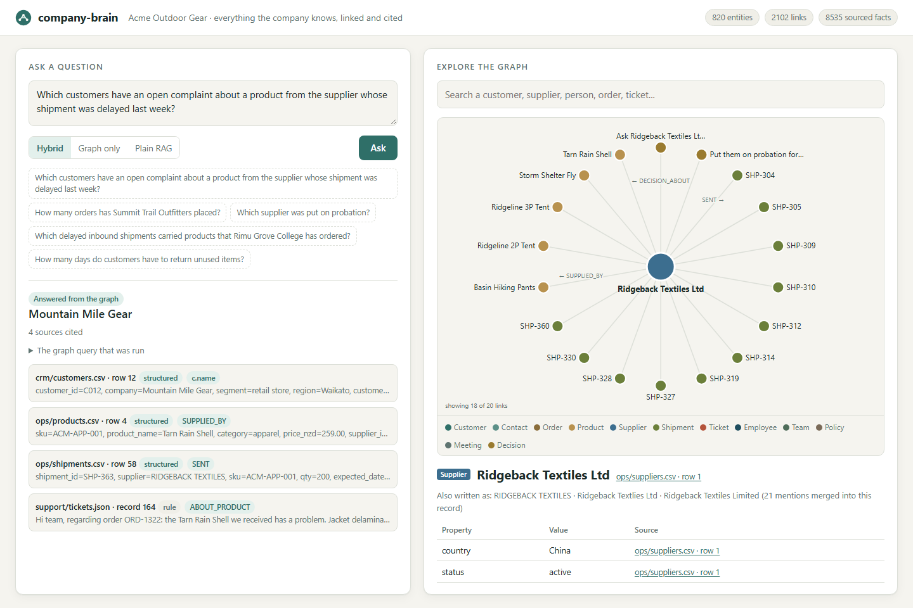
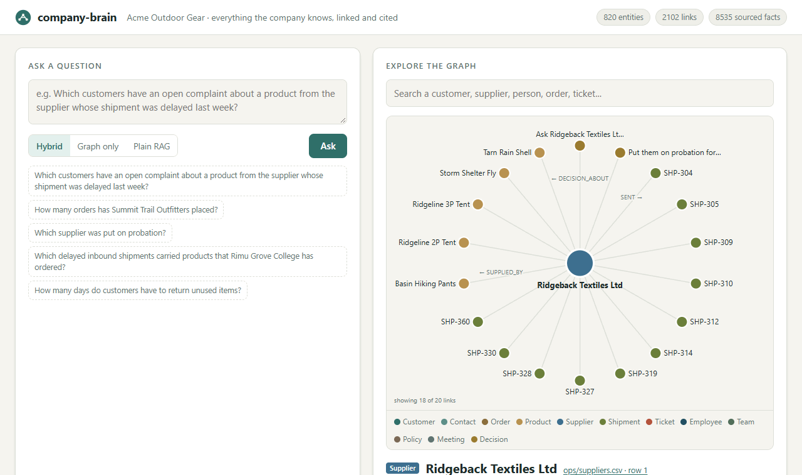
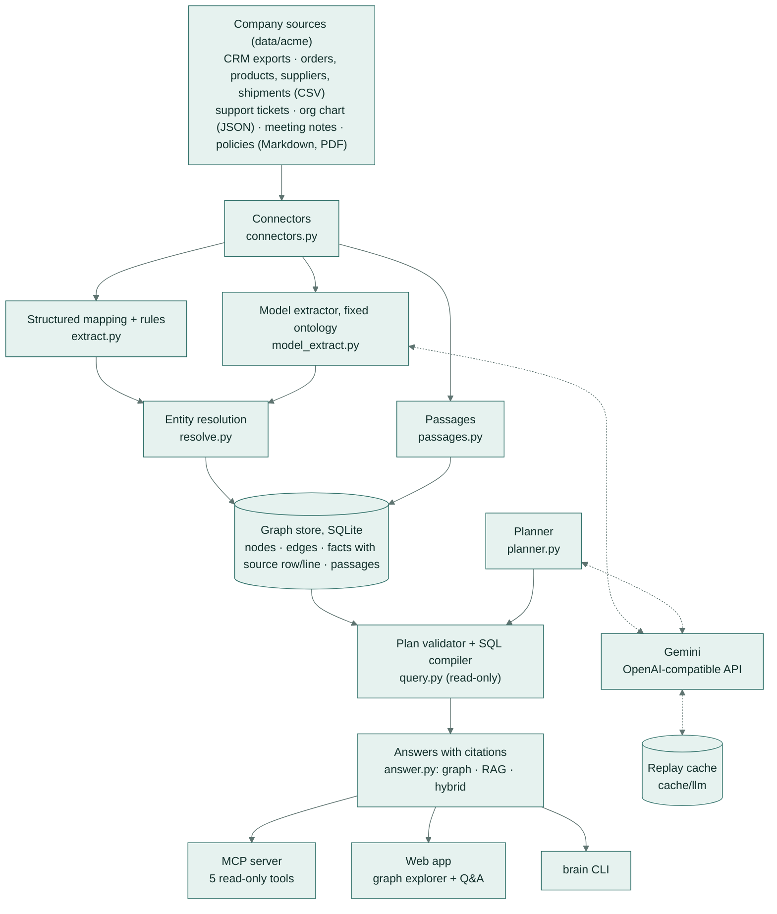
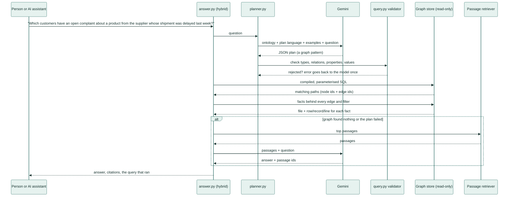
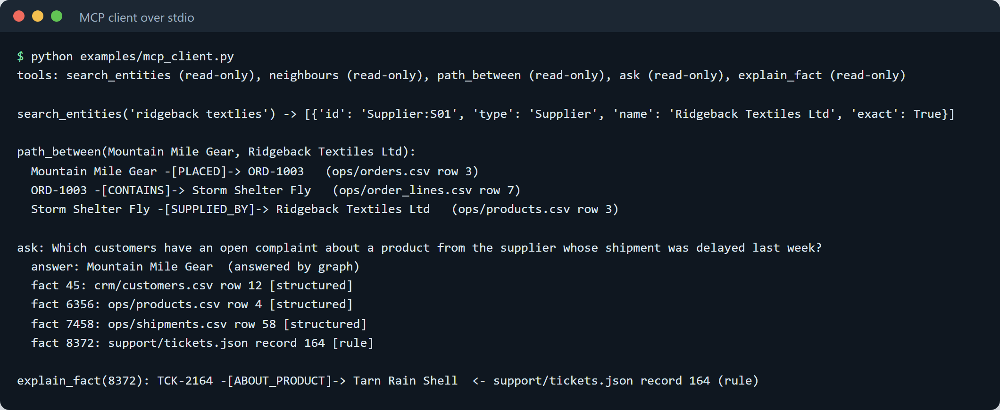
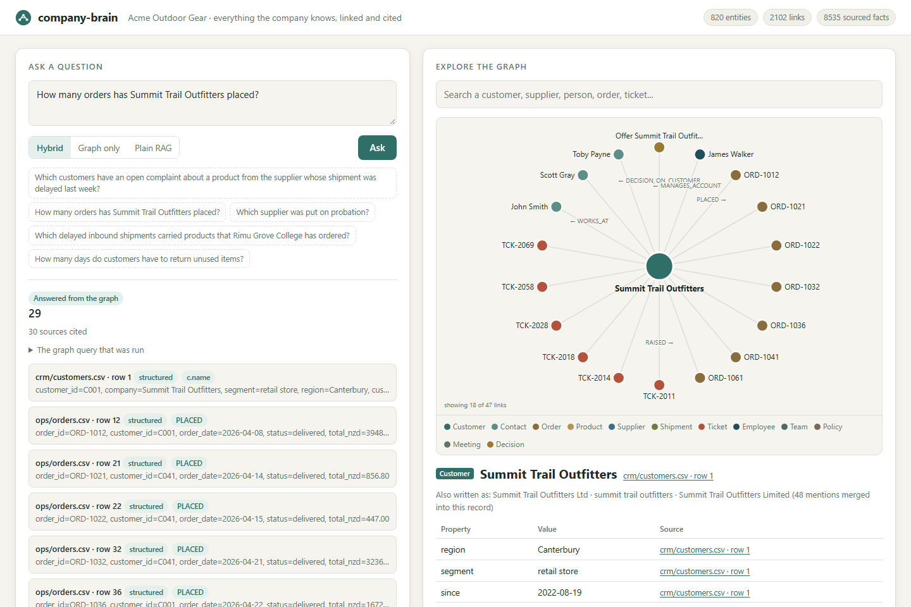
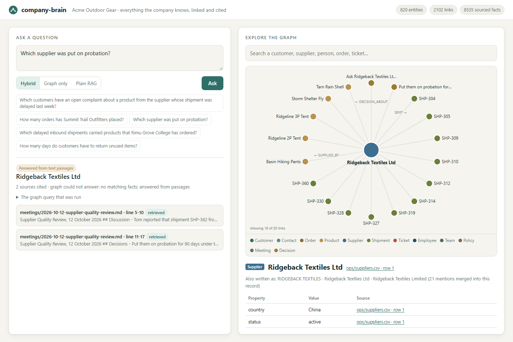
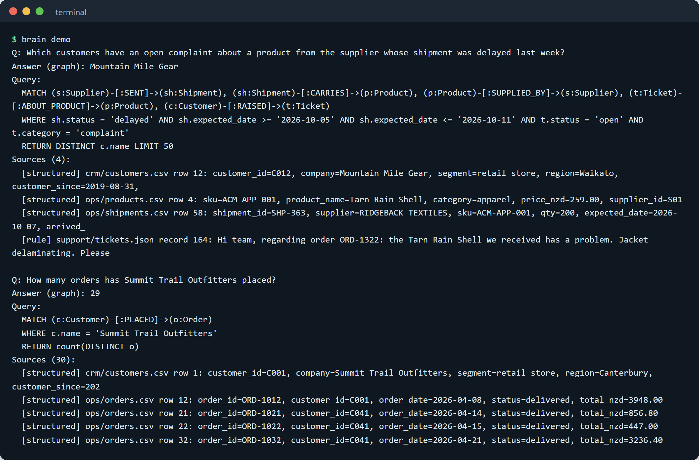

# company-brain

**Ask a question about your business and get an answer that shows exactly where every fact came from.**
company-brain reads a company's customer lists, orders, support tickets, staff list, meeting notes and policy
documents, links them into one map on the company's own computer, and lets people and AI assistants ask questions
that cut across all of them.

[](https://github.com/samiulhuda360/company-brain/actions/workflows/ci.yml)


## What it does

A business keeps what it knows in many separate places: a customer list, order spreadsheets, a support inbox,
meeting notes, policy documents and a staff list. Each one alone is easy to search, but real questions usually need
two or three of them at once, and the same customer is often spelled differently in each. company-brain joins all of
it into one connected map, works out which names mean the same customer, supplier or person, and answers questions
with a link to the exact row or line behind each fact.

## A real-life example

**Sarah runs customer service at Acme Outdoor Gear**, a 40-person outdoor-equipment wholesaler in New Zealand
(an invented company; all of its data in this repository is made up).

- **Before:** a supplier's shipment of rain jackets arrives nine days late. Sarah needs to know which customers who
  already have an open complaint are affected, so the account managers can call them first. She opens the shipment
  spreadsheet to find the supplier, the product list to see what that supplier makes, the support inbox to find open
  complaints about those products, and the customer list to get the names. The same shop appears as "Summit Trail
  Outfitters", "Summit Trail Outfitters Ltd" and "summit trail outfitters" in different places. It takes her most
  of an hour, and she is never quite sure she caught everything.
- **With company-brain:** she types the question in plain English. About two seconds later it answers
  **Mountain Mile Gear** and lists the four records that prove it: the late shipment, the product it carried, the
  open complaint ticket and the customer record. She clicks each one to check it.
- **After:** a cross-checking job that took most of an hour takes about a minute, and every answer comes with its
  evidence, so she can forward it to an account manager without re-checking.

## How you would use it

1. Put the company's exports in one folder: the customer and contact lists, orders, products, suppliers and
   deliveries (spreadsheets), support tickets, the staff list, meeting notes and policy documents.
2. Run one command. company-brain reads everything and builds the map on your own computer. Nothing is uploaded
   except the text it asks the AI model to read, and it can run with no AI at all.
3. Open the page in your browser and type a question, such as "Which supplier was put on probation?"
4. Read the answer. Under it is the list of sources. Click any source to see the exact spreadsheet row, ticket or
   line of meeting notes, highlighted.
5. Use the right-hand side to explore: search for a customer, supplier or person and see everything linked to them,
   then click through.
6. Optionally connect an AI assistant (any desktop AI app or coding tool that supports MCP) to it, so the assistant can look things up in the
   company's records by itself and quote its sources.


*The question from Sarah's story. Left: the answer and the four records that prove it. Right: the supplier
"Ridgeback Textiles Ltd" and what it is linked to: its products, its deliveries and two meeting decisions about it.
"Also written as" shows the different spellings that were recognised as the same supplier.*


*A recorded session: Sarah asks the question, opens the delivery record and the product record behind the answer,
then searches for the customer and clicks through to the complaint ticket.*

## Results at a glance

On 60 questions about the sample company, each with a known correct answer (details in [Evaluation](#evaluation)):

| | Plain document search with AI (the usual approach) | **company-brain** |
|---|---|---|
| Questions answered correctly | 28% | **95%** |
| Questions that join two or three systems | 8% | **92%** |
| Totals and "which is the most" questions | 7% | **93%** |
| Answers that came with their sources | 52% | **97%** |
| Typical time to answer | 1.2 s | 1.5 s |

It also recognised 659 of the 666 differently spelled names in tickets, deliveries and meeting notes as the right
customer, supplier or person, without a single wrong match. The 7 it left alone are genuinely ambiguous
("S. Clarke" could be Sarah or Simon).

---

## How it works

1. **Connectors read every source** (`company_brain/connectors.py`): CSV rows, JSON records, the nested org chart,
   Markdown lines and PDF pages. Every item keeps its exact location: file plus row, record, line or page.
2. **Structured data maps straight onto a fixed ontology** (`ontology.py`: 12 entity types such as Customer, Order,
   Product, Supplier, Shipment, Ticket, Employee, Team, Policy, Meeting and Decision, and 21 relations such as
   PLACED, CONTAINS, SUPPLIED_BY, RAISED, OWNS and DECIDED_IN). An *ontology* here just means the agreed list of
   things and links the graph may hold.
3. **Rules read the free text** (`extract.py`): order numbers and product names in ticket text, attendee lists,
   decision bullets and action owners in meeting notes, and owner and effective date in policies.
4. **A language model reads what rules cannot** (`model_extract.py`): "put *them* on probation" (which supplier?),
   "the free shipping threshold" (which policy?), "Action owner: James" (which James?), and numeric policy terms
   written in prose ("within thirty (30) days"). It must use the ontology and the known names, and cite a line
   number. Anything outside the ontology, out of range or naming nothing known is rejected and logged.
5. **Entity resolution merges duplicates** (`resolve.py`): the same id, the same email, the same organisation name
   once "Ltd", "Limited", "Co", case and punctuation are ignored, a close spelling ("Ridgeback Textlies"), and
   compatible person names ("J. Smith", "Smith, John", "JOHN SMITH") that fit exactly one known person, only within
   the right company. An ambiguous mention ("S. Clarke", when there is a Sarah and a Simon Clarke) is left unmerged.
6. **Everything is stored with provenance** (`build.py`, `store.py`): one SQLite file with nodes, aliases, edges,
   text passages and a `fact` table that records the file, location and extraction method (structured, rule or
   model) behind every property and every link.
7. **A question becomes a graph pattern** (`planner.py`): the model gets the ontology, a small pattern language and
   four examples, and returns a JSON pattern (the same shape as a Cypher `MATCH`). It never writes SQL.
8. **The pattern is checked against an allow-list and run read-only** (`query.py`): unknown types, relations,
   properties, values or extra keys are refused, the pattern must be connected, values are bound as parameters,
   the database is opened read-only, and a step limit stops runaway queries. A rejected pattern goes back to the
   model once with the exact error.
9. **The answer cites its facts**: the engine knows which links and properties produced each answer row, so the
   citations are the facts on the matching paths, not a guess. Counts and sums are taken over distinct entities, so
   joins never double-count.
10. **Hybrid mode** (`answer.py`) answers from the graph when it can, and falls back to retrieved text passages
    when the pattern fails, finds nothing, or names something the graph does not know.

### Architecture



### The main flow: answering a question



### What the pattern language looks like

The question "How many orders has Summit Trail Outfitters placed?" becomes:

```json
{"nodes": [{"var": "c", "type": "Customer", "where": [{"prop": "name", "op": "=", "value": "Summit Trail Outfitters"}]},
           {"var": "o", "type": "Order"}],
 "edges": [{"src": "c", "rel": "PLACED", "dst": "o"}],
 "return": "o", "aggregate": {"func": "count", "var": "o"}}
```

which the engine shows as `MATCH (c:Customer)-[:PLACED]->(o:Order) WHERE c.name = 'Summit Trail Outfitters'
RETURN count(DISTINCT o)`. The name goes through the alias table, so the duplicate CRM account "Summit Trail
Outfitters Ltd" (which holds 11 of the 29 orders) is counted too, and the answer cites all 29 order rows and the
customer record.

### The MCP server

The graph is also an MCP server (MCP, the Model Context Protocol, is the standard way AI assistants connect to
tools). It has five tools, all marked read-only: `search_entities`, `neighbours`, `path_between`, `ask` (answers
with citations) and `explain_fact` (where a fact came from, and every other source that states it).


*A real run of `examples/mcp_client.py`: it finds a supplier despite a typo, traces how a customer is linked to that
supplier with the source of each link, asks the cross-system question and asks where one cited fact came from.*

To use it from an MCP-capable desktop assistant, add a server entry like this to its configuration file:

```json
{"mcpServers": {"company-brain": {"command": "brain", "args": ["--db", "/path/to/company-brain/var/brain.db", "mcp"]}}}
```

### More of the app


*"How many orders has Summit Trail Outfitters placed?" The answer counts orders under both of its CRM accounts and
cites every order row. On the right, the customer with its account manager, contacts, tickets and orders; "Also
written as" lists the spellings merged into this record.*


*"Which supplier was put on probation?" The graph query found nothing (the supplier list still says "active"), so
hybrid mode answered from the meeting-notes passages and says so.*

## Evaluation

**The question set** (`eval/questions.py` → `eval/questions.json`): 60 questions in three groups, written from
templates and answered from the generator's ground truth, never from the graph, so the gold answers are independent
of the system being tested.

- **Single-hop (20):** one link or one fact. "Who is the account manager for Summit Trail Outfitters?", "How many
  days do customers have to return unused items?"
- **Multi-hop (25):** two or three joins across systems. "Which customers have an open complaint about a product
  from the supplier whose shipment was delayed last week?", "Which supplier was put on probation?" (the meeting note
  says "put *them* on probation").
- **Aggregation (15):** counts, sums, averages and "the most". "How many orders has Summit Trail Outfitters placed?"
  (11 of its 29 orders sit under a duplicate CRM account), "Which customer has raised the most complaints?"

Each question also lists its **supporting sources**: the rows, records, lines or pages that prove the answer.

**The systems compared** (all with `gemini-flash-lite-latest`):

- **Plain vector RAG**, the baseline: 365 passages (CSV rows in groups of 10, one ticket each, meeting and policy
  sections, PDF pages) embedded with `gemini-embedding-001`; the top 8 go to the model, which answers and cites
  passage ids.
- **Graph**: the model writes a pattern; the engine answers from the graph.
- **Graph, rules-only extraction**: the same patterns run on a graph built without the model extractor, to show what
  the extractor adds.
- **Hybrid**: graph first, passages when the graph cannot answer.

**How it is scored** (`eval/run_eval.py`):

- *Answer accuracy*: for name answers, every gold name must appear and no other name of the same kind may appear;
  for numbers, the number must appear (exact for counts, within 1% for money, within 5% for an average).
- *Citation precision*: the share of cited sources that are in the question's supporting set (a passage counts if
  its row or line range contains a supporting location). *Citation recall*: the share of supporting locations that
  the citations cover.
- *Multi-hop success rate*: accuracy on the multi-hop group.
- *Entity resolution*: 836 name mentions labelled by the generator with the real entity they refer to; pairwise
  precision and recall, compared with exact matching on ids, emails and names.
- *Latency*: the recorded live model time plus the local query time, per question.

### Results

| | Plain vector RAG | Graph | Graph, rules-only extraction | Hybrid |
|---|---|---|---|---|
| Answer accuracy | 28% | 93% | 87% | **95%** |
| Single-hop accuracy | 70% | 100% | 85% | **100%** |
| Multi-hop success rate | 8% | 88% | 84% | **92%** |
| Aggregation accuracy | 7% | 93% | 93% | **93%** |
| Citation precision | 93% | 93% | 92% | 93% |
| Citation recall | 24% | 89% | 86% | **90%** |
| Answers with no citation | 29 | 3 | 4 | **2** |
| Median latency | 1.20 s | 1.53 s | 1.53 s | 1.54 s |
| 95th percentile latency | 1.50 s | 1.86 s | 1.86 s | 2.50 s |

**Entity resolution** (836 labelled mentions of 167 real entities; 666 of them in tickets, deliveries, meeting
notes and CRM references rather than in a system of record):

| | Pair precision | Pair recall | Wrong merges | Mentions linked to the right record |
|---|---|---|---|---|
| Baseline: exact ids, emails and names | 100% | 50% | 0 | 431 of 666 |
| company-brain resolver | 100% | 96% | 0 | 659 of 666 |

**Facts that exist only in meeting notes and policies** (34 labelled decision links and 6 numeric policy terms):

| | Links found | Link precision | Link recall | Policy terms found |
|---|---|---|---|---|
| Rules only | 30 | 97% | 88% | 0 of 6 |
| Rules + model extractor | 34 | 97% | 100% | 6 of 6 |

**Reading the numbers:**

- Plain RAG does well on single facts that sit in one passage (70%) and fails when the answer has to be assembled:
  in 29 of 60 questions it found no passage that contained the answer and said so. Its citations are mostly correct
  when it gives them (93%) but cover a quarter of the evidence.
- The graph's misses are planning choices, not engine errors: it read "put on probation" as a supplier status field
  (the supplier list still says "active"; the decision is in the meeting notes), took "Ironsand Surf and Trail" for
  a supplier, decided "Glacier Bay Supplies" sounded like a supplier and declined, and added an extra condition to
  one three-system question. Hybrid recovers the first by falling back to passages.
- Graph citation precision on single-hop questions is 83%: the graph also cites the record that names each answer
  (for a team, the first staff record of that team), which is correct evidence but not always in the labelled set.
- Rules-only extraction loses the policy terms and the decisions phrased indirectly; the model extractor adds them
  with 5 calls for the whole document set.
- The extra latency of the graph (about 0.3 s) is the planning call; the graph query itself takes about 3 ms.
- Hand-written patterns for 20 of the questions (`tests/oracle_plans.py`) return the gold answer with only supporting
  citations, so the engine itself is exact; what remains is the planner's reading of the question.

**Model budget:** the whole evaluation used 141 live calls (5 extraction, 16 embedding batches, 60 planning, 60 RAG
answers; no plan needed a repair), all recorded in `cache/llm`. `python eval/run_eval.py --check` replays them with
no key and confirms the results match `eval/results.json`; CI runs it on every push. The full results, per question,
are in `eval/results.json` and `eval/results.md`.

## Tech stack

- **Python 3.11+**, typed throughout (mypy strict) and linted with ruff.
- **SQLite** (standard library) as the embedded graph store: nodes, edges, aliases, provenance facts and passages in
  one file, opened read-only for queries.
- **Pydantic** for the query-pattern schema; **NumPy** for vector search; **pypdf** for PDF policies.
- **Gemini** (`gemini-flash-lite-latest` for planning, extraction and RAG answers; `gemini-embedding-001` for
  passage vectors) through its OpenAI-compatible API, with every reply recorded for offline replay.
- **MCP Python SDK** for the MCP server; **FastAPI** and **Uvicorn** for the web app (plain HTML, CSS and JavaScript,
  no build step).
- **pytest** and **GitHub Actions** for tests and CI.

## Setup, configuration and usage

```bash
python -m venv .venv && source .venv/bin/activate      # Windows: .venv\Scripts\activate
make setup                                             # pip install -e ".[dev]"
make demo                                              # builds the graph and answers three questions
```

No key is needed: the sample data ships with the recorded model replies, so the build, the demo, the web app and the
evaluation all replay them. To run live against Gemini, set the key at run time.

| Environment variable | What it does |
|---|---|
| `AI_API_KEY` | Gemini API key. Without it, everything runs from recorded replies (and falls back to rules and keyword search for anything not recorded). |
| `AI_BASE_URL`, `AI_MODEL`, `AI_EMBED_MODEL` | Point at another OpenAI-compatible provider or model. |
| `AI_MIN_INTERVAL` | Seconds between live calls (for free-tier rate limits). |
| `AI_MAX_CALLS` | Hard cap on live calls recorded in the cache (default 150). |
| `BRAIN_OFFLINE` | `1` forces replay only, even with a key set. |
| `BRAIN_DB` | Graph file (default `var/brain.db`). |

```bash
brain build                          # read data/acme, extract, resolve, store -> var/brain.db
brain build --no-model               # rules only
brain ask "Which supplier has had the most delayed shipments?"
brain ask --mode rag "..."           # or --mode graph; default is hybrid
brain search ridgeback               # find entities by name, alias or email
brain neighbours Customer:C001       # an entity and its links
brain path Customer:C012 Supplier:S01
brain serve --port 8765              # web app at http://127.0.0.1:8765
brain mcp                            # MCP server on stdio
python eval/run_eval.py              # the evaluation (replays recorded replies)
```


*`brain demo`: each answer shows what answered it (the graph or text passages), the query that ran and the sources.*

To use your own data, write connectors for your exports in `extract.py` (each source maps columns to the ontology
in a few lines) and adjust `ontology.py`. `brain generate` rebuilds the sample company.

## Project structure

```
company_brain/
  ontology.py        entity types, properties and relations (the allow-list)
  connectors.py      CSV, JSON, Markdown and PDF readers with exact locations
  extract.py         structured mapping and text rules -> mentions and edges
  model_extract.py   model extraction with the fixed ontology, validated
  resolve.py         entity resolution (and the exact-match baseline)
  build.py           the pipeline: ingest -> extract -> resolve -> store
  store.py           SQLite graph store, read-only access, search, neighbours, paths
  query.py           pattern language, allow-list validator, SQL compiler, executor, citations, Cypher view
  planner.py         question -> pattern, with one repair round
  passages.py        citable text chunks, vector index, BM25 fallback
  answer.py          rag, graph, hybrid and offline lookup modes
  llm.py             OpenAI-compatible client with record/replay cache and call cap
  mcp_server.py      five read-only MCP tools
  web.py, static/    web app: Q&A with citations, graph explorer, source viewer
  cli.py             the `brain` command
  sample/            the invented company generator and a tiny PDF writer
data/acme/           the generated sources (CRM, ops, support, org, meetings, policies)
eval/                questions.py (labelled set from ground truth), run_eval.py, results.json, results.md
cache/llm/           recorded model replies for offline replay
examples/            mcp_client.py
tests/               51 tests, including hand-written plans checked against the gold answers
```

## Tests

```bash
make check     # ruff, ruff format --check, mypy, pytest, then the evaluation replay
```

The 51 tests cover the allow-list (unknown relations, types, properties, enumeration values, extra keys, injection
in names, disconnected patterns), the read-only store, the entity resolver (merges variants, keeps lookalikes like
"Riverstone Outdoors" and "Riverstone Outdoor Club" apart, leaves "S. Clarke" unmerged), model-output validation,
the record/replay cache and call cap, the MCP tools, the web API (including path traversal on the source viewer), the
scoring functions, and 20 hand-written patterns that must return the gold answer with only supporting citations. CI
runs the same commands on Python 3.11, 3.12 and 3.13 with no key, and checks that replaying the evaluation reproduces
`eval/results.json`.

## Sample data

Acme Outdoor Gear and everyone in it are invented. `company_brain/sample/generate.py` builds one consistent world
and writes it out as the sources a real company would have, with realistic mess: a CRM migration that left three
duplicate accounts, company names in tickets typed in capitals, with or without "Ltd", supplier names with typos,
staff named by first name or initials in meeting notes, and two decisions that only make sense from the line before
them. The same world is the ground truth for the evaluation.

## Licence

MIT. See [LICENSE](LICENSE).

